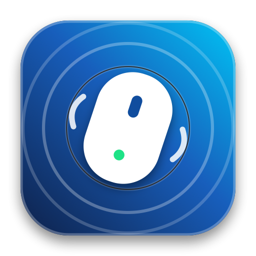
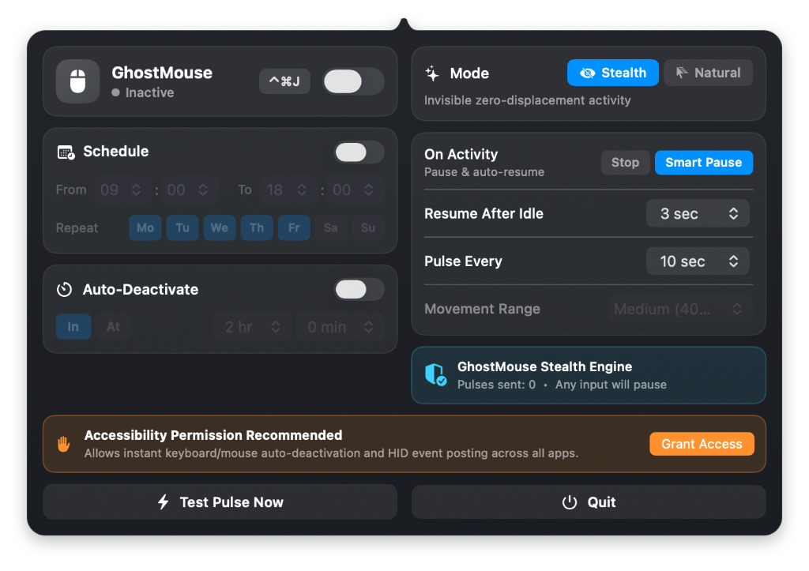

<p align="center">
  
</p>

<h1 align="center">GhostMouse</h1>

<p align="center">
  <strong>Invisible stealth mouse mover & awake utility for macOS — 100% free, open-source, native Swift.</strong>
</p>

<p align="center">
  <a href="https://github.com/joeystdio/GhostMouse/releases/latest/download/GhostMouse.dmg">
    
  </a>
  <a href="https://github.com/joeystdio/GhostMouse/releases/latest">
    
  </a>
  
  <a href="https://buymeacoffee.com/joeystdio">
    
  </a>
</p>

<p align="center">
  
</p>

---

## ✨ Features

- **👻 True Stealth Mode (Invisible)**: Just like the classic Windows Mouse Mover *Stealth* mode, GhostMouse dispatches zero-displacement hardware HID events (`+1/-1` delta at the exact same pixel) combined with `IOPMAssertionDeclareUserActivity`. Your cursor never visibly moves a single pixel on screen, while macOS, Microsoft Teams, and Slack register active input.
- **🖱️ Natural Mode**: Prefer visible movement? Switch to *Natural* mode to smoothly glide the cursor out and back to its exact starting coordinate (`Subtle 5px`, `Medium 40px`, or `Full 150px`).
- **⚡ Instant Activity Deactivation (`Stop` vs `Smart Pause`)**:
  - **Stop**: Automatically turns off the instant you move your physical mouse or press any key on your keyboard.
  - **Smart Pause**: Immediately pauses when you touch your mouse or keyboard, and automatically resumes after your chosen idle delay (`3 sec` – `5 min`).
- **📅 Built-in Schedule**: Automatically restrict activity to specific working hours (`From` / `To`) and weekdays (`Mo`–`Su`).
- **⏱️ Auto-Deactivate Timer**: Automatically shut off after a countdown duration (`In X hr Y min`) or at a specific time of day (`At HH:MM`).
- **⌨️ Global Shortcut & Quick Toggle**:
  - Press **`⌃⌘J`** anywhere in macOS to toggle GhostMouse on or off.
  - **Right-click** the menu bar icon for an instant 1-click toggle, or **left-click** to open the control panel.

---

## 📦 Installation

### Option 1: Homebrew (Recommended)
```bash
brew tap joeystdio/tap
brew install --cask ghostmouse
```

### Option 2: Direct Download (`.dmg`)
1. Download [**`GhostMouse.dmg`**](https://github.com/joeystdio/GhostMouse/releases/latest/download/GhostMouse.dmg) from the [latest release](https://github.com/joeystdio/GhostMouse/releases/latest).
2. Open `GhostMouse.dmg` and drag **GhostMouse.app** into your **Applications** folder.
3. Launch **GhostMouse** and grant **Accessibility** permission when prompted so it can detect physical keyboard/mouse activity and post stealth HID pulses.

> **Note for First Launch (Unnotarized / Open-Source Build)**:
> If macOS Gatekeeper shows a warning on first launch, right-click `GhostMouse.app` → **Open**, or run:
> ```bash
> xattr -cr /Applications/GhostMouse.app
> ```

---

## 🛠️ Building from Source

Requires macOS 14.0+ and Swift 5.10+ / Xcode 15+:

```bash
git clone https://github.com/joeystdio/GhostMouse.git
cd GhostMouse
./release_dmg.sh
```

This compiles a Universal Binary (`arm64` Apple Silicon + `x86_64` Intel), generates the multi-resolution `.icns` icon, bundles `GhostMouse.app`, and packages `GhostMouse.dmg`.

---

## ☕ Support & Buy Me a Coffee

GhostMouse is 100% free and open-source. If it saves your status bar or keeps your workflows humming, consider buying me a coffee!

<p align="left">
  <a href="https://buymeacoffee.com/joeystdio">
    
  </a>
  <a href="https://paypal.me/joeystdio">
    
  </a>
</p>

---

## 📄 License

MIT License — completely free and open source forever.
